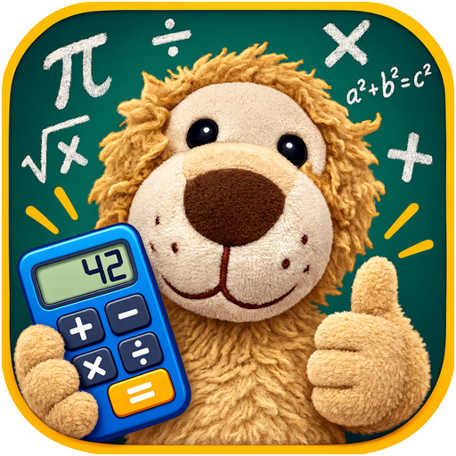

# MatheCraft

**Playful maths practice for primary school, with Leo the lion.**
Explanations, endless practice, a number word trainer and small reward games, in German, English and Spanish.

🇩🇪 [mathecraft.de](https://mathecraft.de) · 🇪🇺 [mathcraft.eu](https://mathcraft.eu) *(coming soon)*

<p>
  
  
  
</p>

---

## What it is

MatheCraft started as a home project: a father building a maths helper for his son in 4th grade. Lessons are organised by the areas of the primary school maths curriculum, and every explanation, picture and exercise is our own. Children earn stars for practising and spend them on short game breaks. Parents see what was practised and where help is needed.

The focus is on **fun and real practice**, not on screen time.

## Features

**For children**
- **Lessons in five steps:** understand (illustrated story, can be read aloud), remember, quick test, practise, puzzles
- **Endless practice:** every round has new numbers; hints after a wrong answer, the solution after the second
- **Number word trainer:** write numbers as words in German, English or Spanish, with tips for typical mistakes (*dreißig*, *sechzehn*, *forty*, *dieciséis*, *quinientos* …)
- **Stars and trophies:** first-try answers earn stars; trophies from 10 to 500 stars
- **Four reward games**, unlocked with stars: jumping game, flying game, space flight, hedge maze (collect cookies, avoid rain clouds)
- **Three languages:** German, English and Spanish, including number formats and place-value abbreviations

**For parents** (protected by a PIN)
- Stars, learning time and play time, chart of the last 14 days
- Strengths and weak spots per task type, most common spelling mistakes
- Activity log
- Settings: game price in stars, play minutes, required tasks before leaving a lesson, games on/off, bonus stars
- Test buttons to try every game without stars

## Curriculum

Lessons are grouped by the four areas of the primary school maths curriculum (as in the German educational standards for grade 4):

| Area | Lessons | Status |
|---|---|---|
| Numbers and calculating | Building a million ✅ · Big numbers made easy ✅ · The number line ✅ · Number patterns and neighbours ✅ · Rounding ✅ · Written multiplication ✅ · Long division 🔜 | 6 of 7 |
| Shapes and space | Right angles, parallel and perpendicular ✅ · Quadrilaterals ✅ · Patterns and tilings ✅ · Area and perimeter 🔜 | 3 of 4 |
| Measuring | Millimetres to kilometres ✅ · Grams, kilograms, tonnes 🔜 · Litres and millilitres 🔜 · Time 🔜 | 1 of 4 |
| Data and chance | Charts ✅ · Chance and probability ✅ | 2 of 2 |

Plus the **number word trainer** (DE / EN / ES), available at any time.

## Run it

No installation and no build step. The whole app is one file.

- **Locally:** download the repository and open `index.html` in a browser.
- **GitHub Pages:** Settings → Pages → Branch `main`, folder `/ (root)`. To use your own domain, enter it there (for example `mathecraft.de`) and point the domain's DNS to GitHub Pages.

Progress is saved in the browser on the device (`localStorage`). When the app runs inside a Claude artifact, it uses that artifact's online storage instead, so progress is shared across devices.

## Project structure

```
index.html            the complete app (HTML, CSS and JavaScript)
assets/               Leo picture, app icons and fonts (self-hosted)
docs/
  PLAN.md             roadmap, decisions and curriculum map
  screenshots/        images used in this README
```

Inside `index.html` the script is organised in sections:

| Section | What it contains |
|---|---|
| Translations | All texts in `L.de`, `L.en`, `L.es`, plus number words for each language |
| Number word checking | Spelling rules with tips (`WRULES`) |
| Lesson | Story steps, quick-test and practice generators (`QGEN`, `GEN`), puzzles (`RGEN`) |
| Trainer | Number word trainer with levels |
| App | Stars, storage, kid area, parent area, required tasks |
| Games | Jumping, flying, space and maze games (canvas) |

**Adding a language:** copy the `L.en` block, translate it, add the language code to `LANGS` and write a number word function like `wordsEN`.

**Adding a lesson:** follow the five-step lesson template and add the lesson to `LESSONS`.

## Roadmap

- More lessons for grade 4, then grades 3 and 5
- Parent accounts and online sync on our own server (EU hosting)
- Installable as an app on phone and tablet (PWA)
- Printable worksheets

## Privacy

Built for children, so it collects as little as possible: no ads, no tracking, no third-party analytics. In this version all data stays on the device.

## Independent content

MatheCraft is an independent project and is not affiliated with any publisher. All explanations, pictures, exercises, characters and games are original.

## License

© 2026 MatheCraft. All rights reserved.

---

### Kurz auf Deutsch

**MatheCraft** ist eine spielerische Mathe-Übungsseite für die Grundschule mit Leo, dem Löwen. Kinder lernen mit Erklärungen, unendlich vielen Übungen und einem Zahlwort-Trainer, sammeln Sterne und lösen sie gegen kurze Spielpausen ein. Eltern sehen im geschützten Elternbereich, was geübt wurde und wo es noch hakt. Die App ist eine einzige HTML-Datei: `index.html` im Browser öffnen, fertig.
